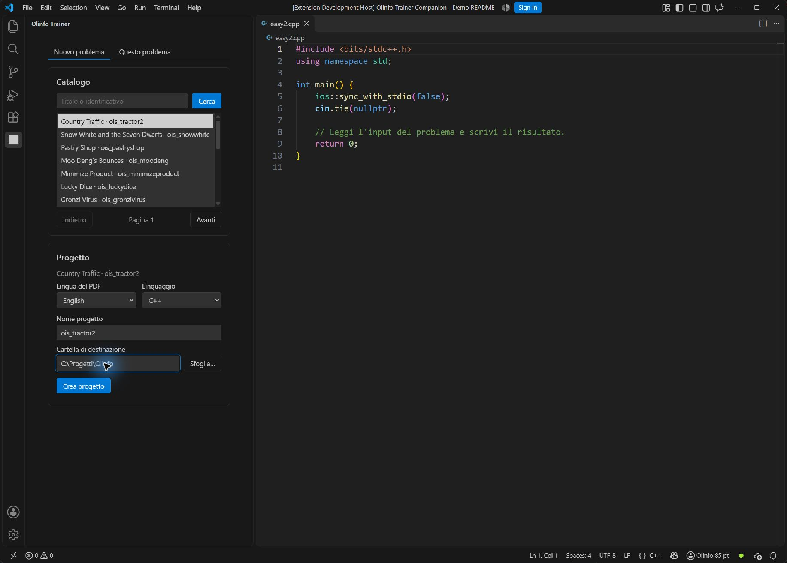
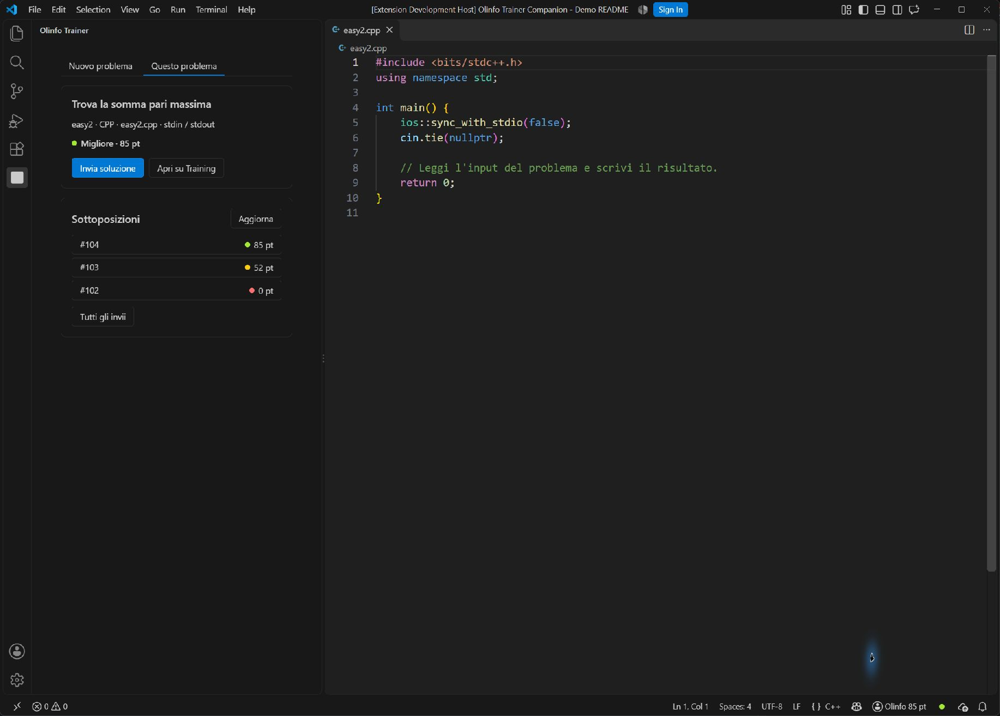
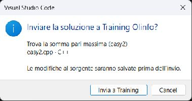

# Olinfo Trainer Companion

Crea progetti per [Training Olinfo](https://training.olinfo.it/) in **VS Code**, **CLion**, **IntelliJ IDEA** e **PyCharm**. Scarica testo e sorgenti, invia la soluzione e segui la valutazione dall’IDE.

[Scarica l’ultima release](https://github.com/LoRy24/Olinfo-Trainer-Companion/releases/latest)

## Installazione

### Visual Studio Code

1. Scarica il file **`.vsix`** dalla release. Serve VS Code Desktop 1.96 o successivo.
2. Apri **Extensions**, fai clic su **…** e scegli **Install from VSIX…**.
3. Seleziona il file scaricato e ricarica la finestra se richiesto. L’icona **Olinfo Trainer** appare nella barra laterale.

Per aggiornare, installa il nuovo `.vsix` allo stesso modo. [Guida di VS Code](https://code.visualstudio.com/docs/configure/extensions/extension-marketplace#_install-from-a-vsix)

### CLion, IntelliJ IDEA e PyCharm

1. Scarica il file **`.zip`** dalla release e lascialo compresso. Serve un IDE JetBrains 2024.3 o successivo.
2. Apri **Settings → Plugins → ⚙ → Install Plugin from Disk…**. Su macOS apri **Settings** dal menu dell’IDE.
3. Seleziona lo ZIP e riavvia se richiesto. Da **New Project** scegli **Olinfo Trainer**, nella sezione **Other** se presente.

Per ricevere gli aggiornamenti nell’IDE, apri **Settings → Plugins → ⚙ → Manage Plugin Repositories…** e aggiungi questo indirizzo. [Guida JetBrains](https://www.jetbrains.com/help/idea/managing-plugins.html#custom-plugin-repositories)

```text
https://github.com/LoRy24/Olinfo-Trainer-Companion/releases/latest/download/updatePlugins.xml
```

## Crea un progetto

Apri **Olinfo Trainer → Nuovo problema**, cerca per nome o identificativo e scegli lingua del PDF, linguaggio e destinazione. Il progetto contiene il PDF, `input.txt`, `output.txt`, `olinfo.xml`, il sorgente e gli eventuali allegati pubblici. [Dettagli sui file generati](docs/USO.md)



## Invia e segui la valutazione

1. Apri la cartella con `olinfo.xml` alla radice. Fai clic su **Olinfo** nella barra di stato e accedi a Training.
2. Premi l’icona **Upload** accanto al punteggio, oppure **Invia soluzione** nella scheda **Questo problema**. Controlla il problema e il file nel dialogo, poi scegli **Invia a Training**.
3. La rotellina segnala l’invio e la valutazione. Il bollino a destra dei punti usa i colori di Training. Nella scheda **Questo problema** trovi gli invii recenti e il collegamento allo storico completo.





Il badge **Olinfo** apre anche il pannello account con foto, punti totali, problemi risolti e posizione in classifica. Per il primo invio, completa la registrazione e accetta le [linee guida di Training](https://training.olinfo.it/guidelines).

## Sviluppo e contributi

[Guida allo sviluppo](docs/SVILUPPO.md) · [Contribuire](CONTRIBUTING.md) · [Codice di condotta](CODE_OF_CONDUCT.md) · [Sicurezza](SECURITY.md) · [Licenza MIT](LICENSE)

Il progetto è indipendente dalle Olimpiadi Italiane di Informatica. L’icona adatta il logo OII. [Attribuzione](assets/oii/NOTICE.md)
